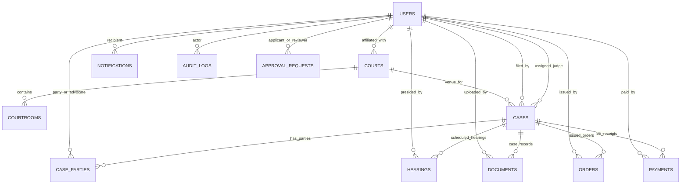

# NyayaDesk - System Architecture & Database Schema Specification

## 1. System Overview & Objectives
NyayaDesk is an end-to-end digital Court Management System (CMS) designed to automate Indian judicial court workflows, ensuring transparency, role governance, speed, and reliability.

### Core Architectural Principles
- **Strict Role-Based Access Control (RBAC)**: All routes and database queries enforce boundary isolation between Government, Registrar, Judge, Clerk, Lawyer, Litigant, and Police.
- **Unified Dignified Aesthetic**: Common design system (`static/css/design-system.css`) rooted in judicial tradition (Navy `#15284F`, Gold `#C49A45`, Slate, Parchment `#F4F6F9`) with Inter and Playfair Display typography.
- **Zero-Build Stack**: Plain HTML, CSS, and Vanilla JavaScript with standard CDN inclusions (Lucide Icons, Chart.js, FullCalendar).
- **Embedded Relational Persistence**: SQLite at `C:\CourtMS\data\court.db` with automated table creation and seed data on startup.
- **Asynchronous Court Automation**: APScheduler for automatic daily cause list publication, notice alerts, and live display board updates.

---

## 2. Relational Database Schema (Entity-Relationship Model)

### Table Definitions

1. **`users`**:
   - `id`: Integer, PK
   - `full_name`: String(120), NOT NULL
   - `email`: String(120), UNIQUE, NOT NULL, INDEX
   - `phone`: String(20), NOT NULL
   - `password_hash`: String(256), NOT NULL
   - `role`: String(32), NOT NULL, INDEX (`government`, `registrar`, `judge`, `clerk`, `lawyer`, `litigant`, `police`)
   - `status`: String(32), DEFAULT 'active', NOT NULL, INDEX (`active`, `pending_gov`, `pending_registrar`, `rejected`, `suspended`)
   - `court_id`: Integer, FK -> `courts.id`, NULLABLE
   - `id_proof_no`: String(100), NULLABLE (bar council no. / employee ID / aadhaar-last4 etc.)
   - `designation`: String(100), NULLABLE
   - `avatar_color`: String(20), DEFAULT '#15284F'
   - `language_pref`: String(10), DEFAULT 'en'
   - `created_at`: DateTime, DEFAULT utcnow
   - `approved_by`: Integer, FK -> `users.id`, NULLABLE
   - `approved_at`: DateTime, NULLABLE
   - `rejection_reason`: Text, NULLABLE

2. **`courts`**:
   - `id`: Integer, PK
   - `name`: String(150), NOT NULL
   - `type`: String(50), NOT NULL (`District`, `High`, `Supreme`, `Family`, `Magistrate`)
   - `city`: String(64), NOT NULL
   - `state`: String(64), NOT NULL
   - `address`: String(255), NULLABLE
   - `code`: String(32), UNIQUE, NOT NULL, INDEX

3. **`courtrooms`**:
   - `id`: Integer, PK
   - `court_id`: Integer, FK -> `courts.id`, NOT NULL
   - `name`: String(64), NOT NULL
   - `capacity`: Integer, DEFAULT 50

4. **`cases`**:
   - `id`: Integer, PK
   - `case_number`: String(64), UNIQUE, NOT NULL, INDEX (e.g. `CIV/2026/00045`)
   - `title`: String(255), NOT NULL
   - `case_type`: String(50), NOT NULL, INDEX (`Civil`, `Criminal`, `Family`, `Property`, `Cheque Bounce`, `Bail`, `Writ`, `Consumer`)
   - `status`: String(50), DEFAULT 'Filed', NOT NULL, INDEX (`Filed`, `Scrutiny`, `Registered`, `Hearing`, `Reserved`, `Judgment`, `Disposed`, `Appealed`)
   - `priority`: String(20), DEFAULT 'Normal', NOT NULL (`Low`, `Normal`, `High`, `Urgent`)
   - `court_id`: Integer, FK -> `courts.id`, NOT NULL
   - `judge_id`: Integer, FK -> `users.id`, NULLABLE
   - `filed_by`: Integer, FK -> `users.id`, NULLABLE
   - `filed_on`: Date, DEFAULT today, NOT NULL
   - `description`: Text, NULLABLE
   - `next_hearing_date`: Date, NULLABLE, INDEX

5. **`case_parties`**:
   - `id`: Integer, PK
   - `case_id`: Integer, FK -> `cases.id`, NOT NULL
   - `user_id`: Integer, FK -> `users.id`, NULLABLE
   - `name`: String(150), NOT NULL
   - `party_type`: String(50), NOT NULL (`Petitioner`, `Respondent`, `Witness`, `Accused`, `Complainant`)
   - `advocate_id`: Integer, FK -> `users.id`, NULLABLE
   - `phone`: String(20), NULLABLE
   - `email`: String(120), NULLABLE

6. **`hearings`**:
   - `id`: Integer, PK
   - `case_id`: Integer, FK -> `cases.id`, NOT NULL
   - `courtroom_id`: Integer, FK -> `courtrooms.id`, NULLABLE
   - `judge_id`: Integer, FK -> `users.id`, NULLABLE
   - `scheduled_at`: DateTime, NOT NULL, INDEX
   - `purpose`: String(150), NOT NULL
   - `status`: String(32), DEFAULT 'Scheduled', NOT NULL, INDEX (`Scheduled`, `Completed`, `Adjourned`, `Cancelled`)
   - `adjournment_reason`: Text, NULLABLE
   - `notes`: Text, NULLABLE

7. **`documents`**:
   - `id`: Integer, PK
   - `case_id`: Integer, FK -> `cases.id`, NOT NULL
   - `uploaded_by`: Integer, FK -> `users.id`, NOT NULL
   - `filename`: String(255), NOT NULL
   - `stored_path`: String(255), NOT NULL
   - `doc_type`: String(64), NOT NULL
   - `version`: Integer, DEFAULT 1
   - `visibility`: String(32), DEFAULT 'Public'
   - `uploaded_at`: DateTime, DEFAULT utcnow

8. **`orders`**:
   - `id`: Integer, PK
   - `case_id`: Integer, FK -> `cases.id`, NOT NULL
   - `judge_id`: Integer, FK -> `users.id`, NOT NULL
   - `title`: String(255), NOT NULL
   - `content`: Text, NOT NULL
   - `order_type`: String(50), NOT NULL (`Interim`, `Final`, `Judgment`, `Notice`)
   - `signed_hash`: String(128), NULLABLE
   - `verification_code`: String(32), NULLABLE, INDEX
   - `issued_at`: DateTime, DEFAULT utcnow

9. **`payments`**:
   - `id`: Integer, PK
   - `case_id`: Integer, FK -> `cases.id`, NULLABLE
   - `user_id`: Integer, FK -> `users.id`, NOT NULL
   - `amount`: Float, NOT NULL
   - `purpose`: String(120), NOT NULL
   - `status`: String(32), DEFAULT 'Completed'
   - `reference`: String(64), UNIQUE, NOT NULL, INDEX
   - `paid_at`: DateTime, DEFAULT utcnow

10. **`notifications`**:
    - `id`: Integer, PK
    - `user_id`: Integer, FK -> `users.id`, NOT NULL
    - `channel`: String(32), NOT NULL (`SMS`, `WhatsApp`, `Email`, `In-App`)
    - `message`: Text, NOT NULL
    - `status`: String(32), DEFAULT 'Sent'
    - `related_case_id`: Integer, FK -> `cases.id`, NULLABLE
    - `scheduled_for`: DateTime, NULLABLE
    - `sent_at`: DateTime, DEFAULT utcnow

11. **`audit_logs`**:
    - `id`: Integer, PK
    - `user_id`: Integer, FK -> `users.id`, NULLABLE
    - `action`: String(64), NOT NULL
    - `entity`: String(64), NULLABLE
    - `entity_id`: Integer, NULLABLE
    - `ip`: String(45), NULLABLE
    - `timestamp`: DateTime, DEFAULT utcnow
    - `details`: Text, NULLABLE

12. **`approval_requests`**:
    - `id`: Integer, PK
    - `applicant_user_id`: Integer, FK -> `users.id`, NOT NULL
    - `requested_role`: String(32), NOT NULL
    - `court_name`: String(150), NULLABLE
    - `details_json`: Text, NULLABLE
    - `status`: String(32), DEFAULT 'Pending', NOT NULL, INDEX (`Pending`, `Approved`, `Rejected`)
    - `reviewed_by`: Integer, FK -> `users.id`, NULLABLE
    - `remarks`: Text, NULLABLE
    - `created_at`: DateTime, DEFAULT utcnow
    - `reviewed_at`: DateTime, NULLABLE

---

## 3. Seed Users & Demo Roster

| Role | Email | Password | Status | Purpose / Name |
|---|---|---|---|---|
| **Government** | `gov@nyaya.in` | `Gov@12345` | active | Ministry of Law & Justice Oversight |
| **Registrar** | `registrar@nyaya.in` | `Reg@12345` | active | Shri V. K. Malhotra (Registrar General) |
| **Judge 1** | `judge1@nyaya.in` | `Judge@12345` | active | Hon'ble Justice Rajesh Sharma (High Court) |
| **Judge 2** | `judge2@nyaya.in` | `Judge@12345` | active | Hon'ble Justice Meenakshi Iyer (Sessions) |
| **Clerk** | `clerk@nyaya.in` | `Clerk@12345` | active | Sunil Gupta (Court Master) |
| **Lawyer 1** | `lawyer1@nyaya.in` | `Lawyer@12345` | active | Adv. Amit Verma |
| **Lawyer 2** | `lawyer2@nyaya.in` | `Lawyer@12345` | active | Adv. Sunita Kapoor |
| **Litigant 1** | `litigant1@nyaya.in` | `Litigant@12345` | active | Ramesh Chandra Gupta |
| **Litigant 2** | `litigant2@nyaya.in` | `Litigant@12345` | active | Priya Sundaram |
| **Litigant 3** | `litigant3@nyaya.in` | `Litigant@12345` | active | Vikramaditya Oberoi |
| **Police** | `police@nyaya.in` | `Police@12345` | active | Inspector Devinder Negi (SHO Tilak Marg) |
| **Pending Judge 1** | `judge_pending1@nyaya.in` | `Judge@12345` | pending_gov | Hon'ble Justice Rameshwar Rao (Waiting Gov Review) |
| **Pending Judge 2** | `judge_pending2@nyaya.in` | `Judge@12345` | pending_gov | Hon'ble Justice Ananya Sen (Waiting Gov Review) |
| **Pending Registrar**| `reg_pending@nyaya.in` | `Reg@12345` | pending_gov | Shri K. S. Raman (Waiting Gov Review) |
